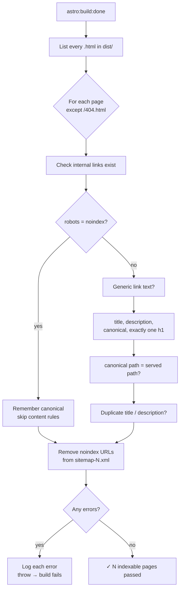
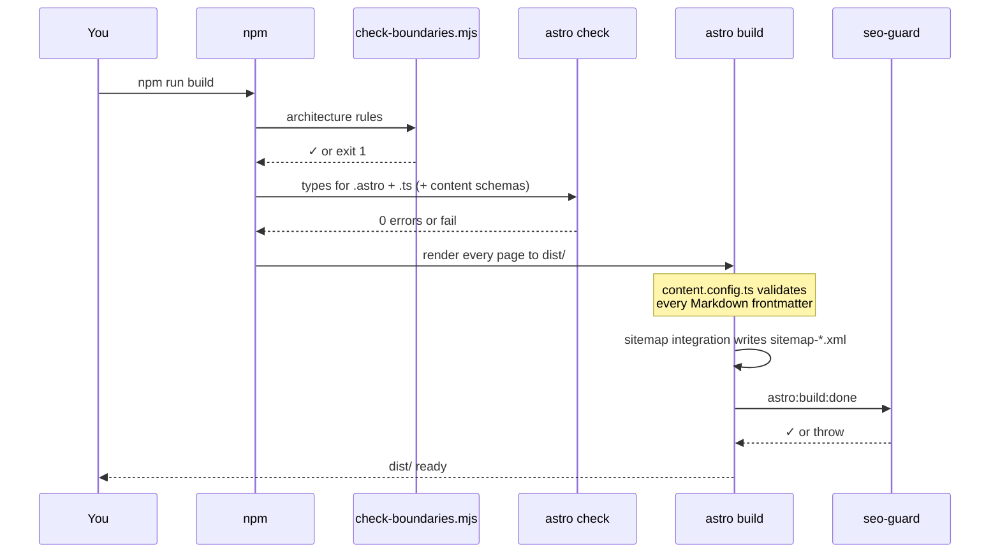

# 3. Astro config, integrations & guards

[← Handbook index](./README.md)

This chapter covers the files that shape the **build**: `astro.config.mjs`, the custom `seo-guard` integration,
the `check-boundaries` script, and the Lighthouse budgets.

---

## 3.1 `astro.config.mjs` — line by line

```js
// @ts-check
import { defineConfig } from 'astro/config';
import { loadEnv } from 'vite';
import tailwindcss from '@tailwindcss/vite';
import sitemap from '@astrojs/sitemap';
import mdx from '@astrojs/mdx';
import seoGuard from './integrations/seo-guard';

const env = loadEnv(process.env.NODE_ENV ?? 'production', process.cwd(), '');
const SITE_URL = process.env.SITE_URL ?? env.SITE_URL;
```

- `// @ts-check` makes TypeScript check this `.mjs` file. That is why `@types/node` is required.
- **`.env` files are not loaded into `process.env` when the config runs.** `loadEnv` from Vite reads them
  explicitly. The order `process.env.SITE_URL ?? env.SITE_URL` means **a real environment variable (CI, host)
  always wins over `.env`**.
- If `SITE_URL` is missing, a warning is printed and the fallback below is used.

| Option                     | Value                                           | What it means for you                                                                                                    |
| -------------------------- | ----------------------------------------------- | ------------------------------------------------------------------------------------------------------------------------ |
| `site`                     | `SITE_URL ?? 'https://samyuktatechnology.com/'` | Becomes `Astro.site` in every page. All absolute URLs (canonical, OG, JSON-LD, sitemap, RSS) are built from it.          |
| `output`                   | `'static'`                                      | Every page is pre-rendered to HTML. No server code runs in production.                                                   |
| `vite.plugins`             | `[tailwindcss()]`                               | Tailwind v4 runs as a Vite plugin. There is **no** `tailwind.config.js`; configuration lives in CSS (`@theme`).          |
| `trailingSlash`            | `'always'`                                      | Every URL ends with `/`. In dev, `/about` (no slash) returns **404**; `/about/` works. `routes.*` always adds the slash. |
| `build.format`             | `'directory'`                                   | `src/pages/about.astro` → `dist/about/index.html`, served at `/about/`.                                                  |
| `image.layout`             | `'constrained'`                                 | Every `<Image />` gets `srcset` + `sizes` and never stretches past its intrinsic width.                                  |
| `image.responsiveStyles`   | `true`                                          | Astro adds the small CSS needed for the responsive layouts.                                                              |
| `prefetch.prefetchAll`     | `true`                                          | Every internal link is prefetched…                                                                                       |
| `prefetch.defaultStrategy` | `'hover'`                                       | …when the visitor hovers or focuses it. Navigation feels instant; this ships a tiny script (~2.5 KB).                    |
| `integrations`             | `[mdx(), sitemap({...}), seoGuard()]`           | See below. **Order matters**: `seoGuard` must come after `sitemap` because it edits the sitemap files.                   |

### The sitemap filter

```js
sitemap({
  filter: (page) => !/\/404$/.test(page) && !page.includes('/blog/page/'),
}),
```

The 404 page and paginated blog pages (`/blog/page/2/` …) are excluded. On top of this, **seo-guard removes every
`noindex` page** from the sitemap after the build (see §3.2), so you never have to maintain an exclusion list by
hand.

## 3.2 `integrations/seo-guard.ts` — the build-time SEO guard

An [Astro integration](https://docs.astro.build/en/reference/integrations-reference/) that hooks into
`astro:build:done`. It runs **after** every page has been written to `dist/`, reads the **real HTML** (not your
source code), and throws an error — failing the build — if it finds a problem.

### How it works



### Every rule it enforces

| #   | Rule                                                                                                                                                   | Applies to      | Typical error message                            |
| --- | ------------------------------------------------------------------------------------------------------------------------------------------------------ | --------------- | ------------------------------------------------ |
| 1   | Page has `<title>`, `<meta name="description">`, `<link rel="canonical">`                                                                              | indexable pages | `/careers/: missing meta description`            |
| 2   | Exactly **one** `<h1>`                                                                                                                                 | indexable pages | `/about/: has 2 <h1> (must be exactly 1)`        |
| 3   | No two pages share a title or a description                                                                                                            | indexable pages | `duplicate <title> on /a/ and /b/: "…"`          |
| 4   | The canonical's path equals the URL the file is served at                                                                                              | indexable pages | `/services/x/: canonical points to /services/y/` |
| 5   | Every internal `<a href="/…">` points to an existing page (or an existing file such as `/rss.xml`)                                                     | **every** page  | `/: broken link → /contact/`                     |
| 6   | Link text is not generic: `click here`, `here`, `read more`, `learn more`, `more`, `more info`, `see more`, `go`, `start`, `this` (arrows are ignored) | indexable pages | `/blog/: non-descriptive link text "Read more"`  |
| —   | `noindex` pages are removed from `sitemap-*.xml`                                                                                                       | noindex pages   | `excluded 1 noindex page(s) from the sitemap`    |

Things worth knowing:

- Link checking ignores `/_astro/` assets, `#anchors` and `?query` strings.
- A link counts as "generic" only when the **whole** link text matches. That is why `ServiceCard` puts its
  "Learn more →" in an `aria-hidden` `<span>` outside the `<a>`: the accessible link text is the service title.
- `/404.html` is skipped entirely.

### Extending seo-guard

Add a new rule inside the `for (const file of files)` loop and `errors.push('…')`. Keep messages in the form
`<url>: <problem>` so they are easy to search. Rules that are "nice to have" belong in the dev-only `auditSeo()`
warnings (`src/lib/seo.ts`) instead, because seo-guard failures block deploys.

## 3.3 `scripts/check-boundaries.mjs` — the architecture guard

A small Node script (`npm run check:boundaries`, also part of `check` and therefore of `build` and `pre-push`).
It scans every `.astro`, `.ts`, `.tsx` and `.mdx` file in **`src/pages`, `src/components` and `src/layouts`**
line by line:

| Rule                       | Regex (simplified)                             | Fix                                          |
| -------------------------- | ---------------------------------------------- | -------------------------------------------- |
| No direct content access   | `getCollection(`, `getEntry(`, `getEntries(`   | Add or use a getter in `src/lib/content.ts`. |
| No hardcoded internal URLs | `href="/something"` without a `.` (not a file) | Use `routes.*` from `@config/routes`.        |

Output on failure:

```
✖ 1 architecture rule violation(s):

src/pages/about.astro:14  Hardcoded internal URL. Use routes.* from @config/routes.
    <a href="/services/">Our services</a>
```

Notes:

- `href="/favicon.svg"` and `href="//cdn…"` are allowed (files and protocol-relative URLs).
- `src/lib/` and `src/config/` are **not** scanned — they are the places that are allowed to talk to content and
  build URLs.
- The check is line-based. It is a safety net, not a parser; code review is still required.

## 3.4 How a build runs, end to end



## 3.5 `lighthouserc.json` — performance & quality budgets

Read by `npm run lighthouse` (Lighthouse CI).

```json
"collect": {
  "staticDistDir": "./dist",
  "url": ["http://localhost/", "http://localhost/services/", "…"],
  "numberOfRuns": 1,
  "settings": { "chromeFlags": "--no-sandbox --headless=new" }
}
```

- **`staticDistDir`** — Lighthouse CI starts its own static server over `dist/`. You must build first.
- **`url`** — one URL per **type** of page (home, services index, service detail, about, blog index, blog post).
  When you add a new _type_ of page (e.g. the first project detail page), add one example URL here.
- **`numberOfRuns: 1`** — one run per URL to keep CI fast.

### The budgets (assertions)

| Assertion                   | Budget        | Fails when…                                                          |
| --------------------------- | ------------- | -------------------------------------------------------------------- |
| `categories:performance`    | ≥ 0.95        | Big images, render-blocking resources, too much JavaScript.          |
| `categories:accessibility`  | ≥ 0.95        | Low contrast, missing alt text, missing labels, bad heading order.   |
| `categories:best-practices` | ≥ 0.95        | Console errors, insecure resources, deprecated APIs.                 |
| `categories:seo`            | **= 1** (100) | Missing meta, `noindex`, non-descriptive links, blocked robots.      |
| `largest-contentful-paint`  | < 2500 ms     | The biggest above-the-fold element appears too late.                 |
| `cumulative-layout-shift`   | < 0.1         | Content jumps while loading (images without dimensions, late fonts). |
| `total-blocking-time`       | < 200 ms      | Long JavaScript tasks block the main thread.                         |

The LCP and CLS budgets match Google's published "good" thresholds for Core Web Vitals (LCP ≤ 2.5 s, CLS ≤ 0.1).
Total Blocking Time is the lab stand-in for INP (good INP ≤ 200 ms in the field). Source:
[web.dev — How the Core Web Vitals thresholds were defined](https://web.dev/articles/defining-core-web-vitals-thresholds).

`upload.target: "filesystem"` writes the reports to `.lighthouseci/` (git-ignored; uploaded as a CI artifact).

### Running Lighthouse locally

```bash
DEPLOY_ENV=production npm run build   # Git Bash / macOS / Linux
npm run lighthouse
```

PowerShell: `$env:DEPLOY_ENV='production'; npm run build; npm run lighthouse`

Without `DEPLOY_ENV=production`, `robots.txt` says `Disallow: /` and the SEO category fails with
"Page is blocked from indexing". That is expected for a normal local build.

**Never audit `npm run dev`.** The dev toolbar and unminified code lower every score. Use `npm run preview` and an
Incognito window if you audit in Chrome DevTools.

Next: [4. Architecture & data flow →](./04-architecture.md)
