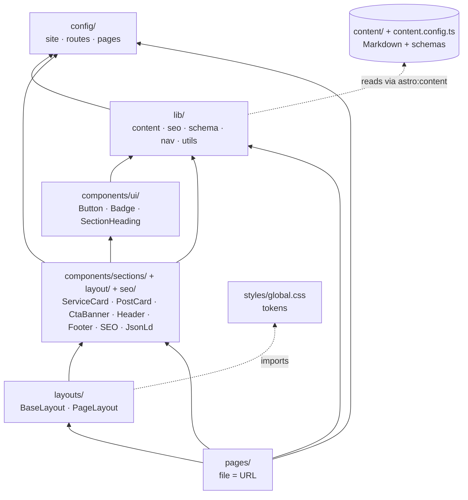
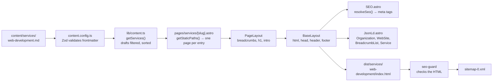

# 4. Architecture & data flow

[← Handbook index](./README.md)

This chapter is the big picture: the layers of the codebase, the one-way import rule, and how a Markdown file
becomes a finished, SEO-checked HTML page.

---

## 4.1 Design principles

The architecture follows a handful of principles. Every rule in this handbook comes from one of them.

| Principle                       | What it means here                                                                                                                                  |
| ------------------------------- | --------------------------------------------------------------------------------------------------------------------------------------------------- |
| **Single source of truth**      | Each fact lives in exactly one file: company identity in `site.ts`, URLs in `routes.ts`, page SEO in `pages.ts`, colours in `global.css`.           |
| **Static first**                | Everything is decided at build time. No database, no API calls, no server in production. Fast, cheap, secure.                                       |
| **Zero JavaScript by default**  | Astro ships HTML and CSS only. Interactivity uses native HTML first (e.g. `<details>` for the mobile menu).                                         |
| **Typed content**               | Markdown frontmatter is validated by Zod schemas. Bad content fails the build instead of shipping a broken page.                                    |
| **Layers with one-way imports** | Lower layers never know about higher ones. You can change a page without touching data logic, and swap data sources without touching pages.         |
| **Guardrails over guidelines**  | Rules that matter are checked by machines (boundaries script, strict TypeScript, seo-guard, Lighthouse) so reviews can focus on design and content. |
| **Pure functions for logic**    | `lib/seo.ts`, `lib/schema.ts`, `lib/nav.ts` and `lib/utils.ts` are plain TypeScript with no Astro rendering. Easy to read, easy to test.            |

## 4.2 The layers



**Imports flow one way only:** `config → lib → components/ui → components/sections → layouts → pages`.
An arrow `A --> B` above means "A may import B". The reverse is forbidden.

| Layer                                     | May import                                                         | Must never import                                            |
| ----------------------------------------- | ------------------------------------------------------------------ | ------------------------------------------------------------ |
| `config/`                                 | nothing (types from `lib/` only, e.g. `PageSeo`)                   | components, layouts, pages, `astro:content`                  |
| `lib/`                                    | `config/`, other `lib/` files, `astro:content` (only `content.ts`) | components, layouts, pages                                   |
| `components/ui/`                          | `lib/` (e.g. `cx`)                                                 | sections, layouts, pages, content                            |
| `components/sections/`, `layout/`, `seo/` | `ui/`, `lib/`, `config/`                                           | layouts, pages, `getCollection`                              |
| `layouts/`                                | components, `lib/`, `config/`, `styles/`                           | pages, `getCollection`                                       |
| `pages/`                                  | everything above                                                   | `getCollection`/`getEntry` (use `@lib/content`), other pages |

> `config/pages.ts` imports the **type** `PageSeo` from `@lib/seo`. A type-only import disappears at runtime, so it
> does not create a real dependency cycle.

## 4.3 How a page is built — the full data flow

Take `/services/web-development/` as an example.



Step by step:

1. **Content.** `src/content/services/web-development.md` has frontmatter (`title`, `summary`, `order`,
   `features`) and a Markdown body.
2. **Schema.** `src/content.config.ts` defines the `services` collection with a `glob()` loader and a Zod schema.
   If `summary` is longer than 200 characters, the build fails with `InvalidContentEntryDataError`.
3. **Data access.** `getServices()` in `src/lib/content.ts` calls `getCollection('services', isPublished)` —
   hiding drafts in production — and sorts by `order`.
4. **Routing.** `src/pages/services/[slug].astro` exports `getStaticPaths()`, returning one
   `{ params: { slug: service.id }, props: { service } }` per service. The entry `id` is the file name, so the
   URL is `/services/web-development/`.
5. **Rendering.** The page calls `render(service)` to turn the Markdown body into a `<Content />` component, builds
   a `seo` object, and builds a `Service` JSON-LD object with `serviceSchema()`.
6. **Layouts.** It renders inside `PageLayout` (breadcrumbs + the single `<h1>` + intro), which renders inside
   `BaseLayout` (the HTML document: `<head>`, skip link, `Header`, `<main>`, `Footer`).
7. **Head.** `BaseLayout` renders `SEO.astro`, which turns the `seo` object into final tags with `resolveSeo()`,
   and `JsonLd.astro`, which serialises `Organization` + `WebSite` + `BreadcrumbList` + the page's own `Service`.
8. **Output.** Astro writes `dist/services/web-development/index.html`.
9. **Verification.** After all pages are written, `seo-guard` reads the HTML and checks titles, descriptions,
   canonicals, `<h1>` count, duplicates and links. The sitemap integration has already listed the page; seo-guard
   would remove it if it were `noindex`.

## 4.4 How the systems communicate

There is no runtime communication — everything happens at build time through **imports and props**.

| From → To                             | Channel                            | What is passed                                                  |
| ------------------------------------- | ---------------------------------- | --------------------------------------------------------------- |
| Markdown → `lib/content.ts`           | `astro:content` `getCollection`    | Validated, typed entries (`CollectionEntry<'blog'>`).           |
| `lib/content.ts` → pages              | function calls                     | Sorted, filtered arrays (`Service[]`, `Post[]`, `TagGroup[]`).  |
| `config/pages.ts` → pages             | import                             | A `PageSeo` object per static page.                             |
| `config/routes.ts` → everything       | import                             | URL builder functions, `mainNav`, `footerNav`.                  |
| `config/site.ts` → `lib/`, components | import                             | Company identity, contact, social, title template.              |
| Page → `PageLayout` → `BaseLayout`    | **props**                          | `seo`, `heading`, `intro`, `breadcrumbs`, `schema`.             |
| Page → layout                         | **named slots**                    | `head` (extra `<head>` tags), `header-extra` (under the intro). |
| `BaseLayout` → `SEO.astro`            | props + `Astro.url` + `Astro.site` | `seo` → `resolveSeo()` → `ResolvedSeo`.                         |
| `BaseLayout` → `JsonLd.astro`         | props                              | `JsonLdObject[]` built by `lib/schema.ts`.                      |
| `astro.config.mjs` → every page       | `Astro.site`                       | The absolute origin used for every absolute URL.                |
| Environment → build                   | `SITE_URL`, `DEPLOY_ENV`           | Origin; whether `robots.txt` allows indexing.                   |
| `dist/` → `seo-guard`                 | file system                        | The finished HTML and sitemap files.                            |

### The props contract of the layouts

```ts
// PageLayout (inner pages)
interface Props {
  seo: PageSeo; // required — title + description at minimum
  heading: string; // required — becomes the page's only <h1>
  intro?: string | undefined;
  breadcrumbs?: Crumb[]; // WITHOUT "Home" — layouts prepend it
  schema?: JsonLdObject[]; // page-specific JSON-LD (Service, BlogPosting…)
}

// BaseLayout (home and 404 use it directly; they render their own <h1>)
interface Props {
  seo: PageSeo;
  breadcrumbs?: Crumb[];
  schema?: JsonLdObject[];
}
```

## 4.5 What runs in the browser

Almost nothing:

- **HTML + one CSS file** generated by Tailwind.
- **Astro's prefetch script** (~2.5 KB) — prefetches internal links on hover/focus.
- The mobile menu is a native `<details>` element — no JavaScript.

If you ever need interactivity, prefer, in order: native HTML (`<details>`, `<dialog>`, form validation) →
a small `<script>` in the component → an Astro island with a UI framework (requires adding an integration —
discuss with the lead first; it affects the Lighthouse performance budget).

## 4.6 Where to put new code — decision table

| You are adding…                                     | Put it in…                                                                        |
| --------------------------------------------------- | --------------------------------------------------------------------------------- |
| A new URL                                           | `src/config/routes.ts`                                                            |
| A company fact (address, social link)               | `src/config/site.ts`                                                              |
| Title/description for a static page                 | `src/config/pages.ts`                                                             |
| A new kind of content (projects, team, FAQ)         | `src/content.config.ts` + `src/content/<name>/` + getters in `src/lib/content.ts` |
| A way to sort/filter/group content                  | `src/lib/content.ts`                                                              |
| A pure helper (formatting, slugs)                   | `src/lib/utils.ts`                                                                |
| A new JSON-LD type                                  | `src/lib/schema.ts`                                                               |
| A generic visual primitive (button, tag, input)     | `src/components/ui/`                                                              |
| A composed block (card, banner, hero, FAQ list)     | `src/components/sections/`                                                        |
| Site chrome (header, footer, container)             | `src/components/layout/`                                                          |
| A colour, font, radius or width                     | `src/styles/global.css` `@theme`                                                  |
| An image used by a component or content             | `src/assets/images/` (processed and optimised)                                    |
| A file that must keep its exact URL (favicon, logo) | `public/`                                                                         |
| A page                                              | `src/pages/`                                                                      |
| A build-time check                                  | `integrations/seo-guard.ts` or `scripts/check-boundaries.mjs`                     |

Next: [5. `src/` reference — file by file →](./05-src-reference.md)
