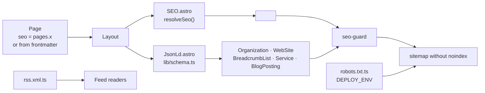

# 6. SEO patterns

[← Handbook index](./README.md)

SEO is not a task at the end of a project here — it is built into the architecture. This chapter explains each
pattern, where it lives in the code, and what you must do (usually: very little) when you add a page.

---

## 6.1 The SEO system on one page



| Pattern                       | Where                                           | Your job when adding a page                          |
| ----------------------------- | ----------------------------------------------- | ---------------------------------------------------- |
| Title + description           | `config/pages.ts` or frontmatter                | Write them. Unique, honest, within length limits.    |
| Title template                | `site.titleTemplate`                            | Nothing.                                             |
| Canonical URL                 | `resolveSeo()`                                  | Nothing (override only for republished content).     |
| Robots / noindex              | `seo.noindex`                                   | Set `noindex: true` for thin, utility or demo pages. |
| Open Graph & Twitter cards    | `SEO.astro`                                     | Optionally pass `ogImage` + `ogImageAlt`.            |
| JSON-LD structured data       | `lib/schema.ts` + `BaseLayout`                  | Pass `breadcrumbs`; pass `schema` for typed pages.   |
| Breadcrumbs                   | `PageLayout` → `Breadcrumbs` + `BreadcrumbList` | Pass `breadcrumbs` (without Home).                   |
| Sitemap                       | `@astrojs/sitemap` + seo-guard                  | Nothing.                                             |
| robots.txt                    | `pages/robots.txt.ts`                           | Nothing.                                             |
| RSS                           | `pages/rss.xml.ts`                              | Nothing (blog posts only).                           |
| Headings                      | `PageLayout` `<h1>`, `SectionHeading` `<h2>`    | One `<h1>`; never skip levels.                       |
| Link text                     | seo-guard rule 6                                | Descriptive text, never "Learn more" alone.          |
| Performance (Core Web Vitals) | static output, `<Image />`, Lighthouse CI       | Follow the image rules; don't add heavy JavaScript.  |

---

## 6.2 Titles

```ts
// lib/seo.ts
formatTitle(title, absolute) → absolute ? title : site.titleTemplate.replace('%s', title)
// 'Projects & Case Studies' → 'Projects & Case Studies | Samyukta Technology'
```

- Write only the **page part** of the title; the suffix ` | Samyukta Technology` (24 characters) is added for you.
- The **final** title should be **30–60 characters** (`SEO_LIMITS`). So the part you write should be roughly
  **6–36 characters**. In dev, `SEO.astro` warns in the terminal: `[seo] /about/: title is 68 chars (aim 30–60)`.
- The home page uses `absoluteTitle: true` and carries the brand itself.
- Every title must be **unique** — seo-guard fails on duplicates.
- Describe the page truthfully; put the most important words first.

Why: Google builds the clickable "title link" in results mainly from the `<title>` element and the page's main
visible heading, and it rewrites titles that are vague, stuffed or inaccurate. Source:
[Google Search Central — Influencing your title links](https://developers.google.com/search/docs/appearance/title-link).
The 60-character limit is a house rule to avoid truncation, not a Google rule.

## 6.3 Meta descriptions

- **70–160 characters**, unique per page (seo-guard fails on duplicates; the schema enforces the range for blog
  posts and `seo.description` overrides).
- Write a one- or two-sentence summary that would make someone click: what the page offers and for whom.
- Never claim what you cannot back up ("reply within one business day", "#1 in Nepal") unless the business has
  confirmed it.

Google may show your description as the snippet, or may generate its own from page content — a good description
raises the chance it is used. See [Google Search Central — snippets](https://developers.google.com/search/docs/appearance/snippet).

## 6.4 Canonical URLs & the trailing-slash rule

```ts
canonical: absoluteUrl(input.canonical ?? normalizePath(pathname), siteUrl);
// → https://samyuktatechnology.com/services/web-development/
```

- Every page gets a self-referencing canonical built from `SITE_URL` + the normalised path.
- **One URL per page, always with a trailing slash.** `trailingSlash: 'always'`, `build.format: 'directory'`,
  `routes.*` and `normalizePath()` all agree on the same shape, and seo-guard rule 4 verifies the canonical equals
  the served path.
- Why it matters: search engines treat `/about` and `/about/` as **different URLs**; serving both splits signals
  and creates duplicates. Pick one form and make the other redirect. Source:
  [Google Search Central blog — To slash or not to slash](https://developers.google.com/search/blog/2010/04/to-slash-or-not-to-slash).
- **Hosting requirement:** configure the host to 301-redirect non-slash URLs to the slash version.
- Override `seo.canonical` **only** when the content is republished from another URL that should rank instead.

## 6.5 Robots: `noindex`, robots.txt and environments

Two separate controls:

| Control                | Scope      | Set by        | Effect                                                             |
| ---------------------- | ---------- | ------------- | ------------------------------------------------------------------ |
| `<meta name="robots">` | one page   | `seo.noindex` | `noindex, nofollow` vs `index, follow, max-image-preview:large`.   |
| `/robots.txt`          | whole site | `DEPLOY_ENV`  | Production: `Allow: /` + `Sitemap:`. Anything else: `Disallow: /`. |

Use `noindex: true` for: the 404 page, tag pages with fewer than 2 posts (automatic), demo/test pages, thank-you
pages, and any page with little unique content. A `noindex` page:

- is skipped by seo-guard's content rules (but its links are still checked),
- is **removed from the sitemap automatically** by seo-guard,
- keeps its canonical (harmless).

## 6.6 Open Graph & Twitter cards

`SEO.astro` always emits `og:type`, `og:site_name`, `og:locale`, `og:url`, `og:title`, `og:description`,
`og:image` (+ `alt`, `width` 1200, `height` 630) and the matching `twitter:*` tags with
`summary_large_image`.

- Default image: `site.defaultOgImage` (`/og-default.png` in `public/`, must be **1200×630**).
- Blog posts generate their own 1200×630 JPG from the cover at build time:
  ```ts
  const og = await getImage({ src: data.cover, width: 1200, height: 630, format: 'jpg', fit: 'cover' });
  ```
- Blog posts pass `article` → `og:type=article` plus `article:published_time`, `modified_time`, `author`, `tag`.
- Check a page's card before launch with LinkedIn's Post Inspector or Facebook's Sharing Debugger.

## 6.7 Structured data (JSON-LD)

Every page:

```json
{ "@type": "Organization", "@id": "https://…/#organization", "name": "Samyukta Technology", … }
{ "@type": "WebSite", "@id": "https://…/#website", "publisher": { "@id": "https://…/#organization" } }
```

Plus, per page type:

| Page                      | Extra schema                                      | Built by                                 |
| ------------------------- | ------------------------------------------------- | ---------------------------------------- |
| Any page with breadcrumbs | `BreadcrumbList` (Home first)                     | `BaseLayout` from the `breadcrumbs` prop |
| Service detail            | `Service` with `provider → #organization`         | `serviceSchema()`                        |
| Blog post                 | `BlogPosting` with author, dates, image, keywords | `blogPostingSchema()`                    |

Patterns to follow:

- **Same source as the visible page.** The `BreadcrumbList` is built from the same `breadcrumbs` prop as the
  visible trail, and descriptions come from the same `seo` object. Structured data must describe what users see.
- **Reference, don't repeat.** Use `{ '@id': orgId }` to point at the organisation.
- **Absolute URLs** everywhere (`abs(path, siteUrl)`).
- **Safe serialisation.** `JsonLd.astro` escapes `<`, so a title containing `</script>` cannot break the page.
- To add a type (e.g. `FAQPage`, `CreativeWork` for projects), add a builder in `lib/schema.ts` and pass it
  through the page's `schema` prop. Validate with the [Schema.org validator](https://validator.schema.org) and
  Google's [Rich Results Test](https://search.google.com/test/rich-results).

## 6.8 Headings & content structure

- **Exactly one `<h1>` per page** (seo-guard rule 2). `PageLayout` renders it from `heading`. Home and 404 write
  their own.
- Sections start at `<h2>` — use `SectionHeading`. Card titles are `h2` or `h3` depending on context
  (`headingLevel`).
- Markdown bodies start at `##`. The blog's "On this page" table of contents is built from the H2s.
- Never pick a heading level for its size. Style with classes, structure with levels.

## 6.9 Links

- Internal links: `routes.*` only (architecture check), always with trailing slash, verified by seo-guard rule 5.
- Link text must say where it goes (seo-guard rule 6, Lighthouse `link-text`). "Learn more" is allowed only as a
  decorative `aria-hidden` element next to a real, descriptive link — see `ServiceCard`.
- External links: full `https://` URLs. Add `rel="noopener"` if you use `target="_blank"` (better: don't open new
  tabs).

## 6.10 Sitemap, RSS and discovery

- `@astrojs/sitemap` writes `sitemap-index.xml` + `sitemap-0.xml` from every built page, minus 404 and
  `/blog/page/*`; seo-guard then removes `noindex` pages.
- `BaseLayout` adds `<link rel="sitemap">` and an RSS `<link rel="alternate">` to every page.
- `robots.txt` (production) points at the sitemap.
- After launch, submit `https://samyuktatechnology.com/sitemap-index.xml` in Google Search Console.

## 6.11 Performance is SEO

Google uses Core Web Vitals as a ranking signal. "Good" means **LCP ≤ 2.5 s, INP ≤ 200 ms, CLS ≤ 0.1** at the 75th
percentile ([web.dev](https://web.dev/articles/defining-core-web-vitals-thresholds)). The architecture handles most
of it — static HTML, no framework JavaScript, optimised images, hover prefetch — and Lighthouse CI guards it
(chapter 3 §3.5). You keep it that way by:

- giving every `<Image />` a `width` and `height` (CLS),
- marking only the hero / first visible image as `eager` + `fetchpriority="high"` (LCP),
- not adding client-side frameworks or third-party scripts without discussing the budget (INP/TBT),
- keeping source images under ~500 KB.

## 6.12 Content-level SEO checklist

Before you open a PR that adds or changes a page:

- [ ] Title is unique, describes the page, final length 30–60.
- [ ] Description is unique, 70–160, honest, written for humans.
- [ ] One `<h1>`; headings in order; body starts at H2.
- [ ] Breadcrumbs passed (inner pages).
- [ ] Images have real `alt` text and dimensions.
- [ ] Links have descriptive text and use `routes.*`.
- [ ] Thin, duplicate or utility page? → `noindex: true`.
- [ ] Not duplicating another page's content (two near-identical service pages compete with each other).
- [ ] `npm run build` passes seo-guard.

Next: [7. Design system & UI rules →](./07-design-system.md)
