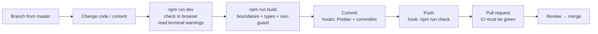

# 8. Recipes — step-by-step workflows

[← Handbook index](./README.md)

Copy-and-follow instructions for the work you will actually do. Every recipe ends with the same verification step.

- [8.1 The workflow for every change](#81-the-workflow-for-every-change)
- [8.2 Static page — About (build it out)](#82-static-page--about-build-it-out)
- [8.3 Static page — Contact (enable a planned route)](#83-static-page--contact-enable-a-planned-route)
- [8.4 Demo / playground page (noindex)](#84-demo--playground-page-noindex)
- [8.5 New service](#85-new-service)
- [8.6 New blog post](#86-new-blog-post)
- [8.7 New content type: Projects, end to end](#87-new-content-type-projects-end-to-end)
- [8.8 New section component with structured data: FAQ](#88-new-section-component-with-structured-data-faq)
- [8.9 Small recipes: nav item, token, env variable](#89-small-recipes)

---

## 8.1 The workflow for every change



```bash
git checkout master && git pull
git checkout -b feat/contact-page
# … work …
npm run dev            # look at it; watch for [seo] warnings in the terminal
npm run build          # must end with "✓ N indexable pages passed SEO checks"
git add -A
git commit -m "feat(pages): add contact page"
git push -u origin feat/contact-page
```

**The question to ask before every new page:** _Is this a static page (one URL, hand-written) or a content page
(many URLs, one per Markdown file)?_ Static → recipes 8.2–8.4. Content → 8.5–8.7.

---

## 8.2 Static page — About (build it out)

`/about/` already exists as a placeholder. This recipe shows the anatomy of a static page and builds it into a
real one.

### The four touch points of any static page

| #   | File                    | What                            | About status |
| --- | ----------------------- | ------------------------------- | ------------ |
| 1   | `src/config/routes.ts`  | `about: () => '/about/'`        | ✓ exists     |
| 2   | `src/config/pages.ts`   | `about: { title, description }` | ✓ exists     |
| 3   | `src/pages/about.astro` | The page, using `PageLayout`    | placeholder  |
| 4   | `routes.ts` nav arrays  | `mainNav` / `footerNav` entries | ✓ in both    |

### Step 1 — write the page

Use **only** real, confirmed facts (the mission and vision below are from the live site). Pull company details
from `site`, never type them.

```astro
---
// src/pages/about.astro
import PageLayout from '@layouts/PageLayout.astro';
import Container from '@components/layout/Container.astro';
import SectionHeading from '@components/ui/SectionHeading.astro';
import Button from '@components/ui/Button.astro';
import CtaBanner from '@components/sections/CtaBanner.astro';
import { pages } from '@config/pages';
import { routes } from '@config/routes';
import { site } from '@config/site';
import { getServices } from '@lib/content';

const services = await getServices();
---

<PageLayout
  seo={pages.about}
  heading="About Samyukta Technology"
  intro="We combine deep technical expertise with a customer-first mindset to deliver reliable, scalable IT solutions."
  breadcrumbs={[{ label: 'About', href: routes.about() }]}
>
  <Container as="section" class="grid gap-12 py-16 lg:grid-cols-2">
    <div>
      <SectionHeading title="Our mission" />
      <p class="mt-4 text-lg">
        To deliver secure, compliant and scalable technology solutions that help our clients reach their
        business goals.
      </p>
    </div>
    <div>
      <SectionHeading title="Our vision" />
      <p class="mt-4 text-lg">
        To be a trusted technology partner, recognised for turning complex challenges into digital solutions
        that help businesses grow.
      </p>
    </div>
  </Container>

  <Container as="section" class="py-16">
    <SectionHeading title="What we do" />
    <ul class="mt-8 grid gap-4 md:grid-cols-2">
      {services.map((service) => (
        <li>
          <a href={routes.service(service.id)} class="font-semibold hover:text-brand-700">
            {service.data.title}
          </a>
          <p class="text-muted">{service.data.summary}</p>
        </li>
      ))}
    </ul>
    <Button href={routes.services()} variant="secondary" class="mt-10">
      Explore all our services
    </Button>
  </Container>

  <Container as="section" class="py-16">
    <SectionHeading title="Where we are" />
    <address class="mt-4 text-lg not-italic">
      {`${site.contact.address.street}, ${site.contact.address.city} ${site.contact.address.postalCode}`}
    </address>
  </Container>

  <CtaBanner />
</PageLayout>
```

What to notice:

- **One `<h1>`**, rendered by `PageLayout` from `heading`. Each section uses `SectionHeading` → `<h2>`.
- **No hardcoded URLs** — `routes.service(...)`, `routes.services()`.
- **No hardcoded company info** — the address comes from `site.contact`.
- **Descriptive link text** — "Explore all our services", not "Learn more".
- **Data comes from `@lib/content`**, never from `getCollection()`.

### Step 2 — check the SEO entry

`pages.about` in `src/config/pages.ts` is already filled in. If you change it, keep the final title 30–60 and the
description 70–160, and make sure no other page has the same text.

### Step 3 — verify

```bash
npm run dev     # open http://localhost:4321/about/ — no [seo] warnings in the terminal
npm run build   # seo-guard passes
```

`/about/` is already in `lighthouserc.json`, so CI will measure it.

---

## 8.3 Static page — Contact (enable a planned route)

`contact` is planned: its SEO entry exists in `pages.ts`, but the route and nav links are commented out, and the
"Start a project" buttons have no destination yet.

### Step 1 — enable the route (`src/config/routes.ts`)

```ts
export const routes = {
  home: () => '/',
  about: () => '/about/',
  contact: () => '/contact/',        // ← uncomment
  // …
```

and in `footerNav`:

```ts
{
  title: 'Company',
  links: [
    { label: 'About', href: routes.about() },
    { label: 'Contact', href: routes.contact() },   // ← uncomment
  ],
},
```

> If you stop here and build, **seo-guard fails**: `broken link → /contact/`. That is the guard doing its job —
> a route without a page is a broken link.

### Step 2 — create the page (`src/pages/contact.astro`)

A static site has no server to receive form posts. Until the lead chooses a form service, the page offers email
and phone. A pre-filled `mailto:` link is honest and works everywhere.

```astro
---
import PageLayout from '@layouts/PageLayout.astro';
import Container from '@components/layout/Container.astro';
import SectionHeading from '@components/ui/SectionHeading.astro';
import Button from '@components/ui/Button.astro';
import { pages } from '@config/pages';
import { routes } from '@config/routes';
import { site } from '@config/site';

const { email, phone, address } = site.contact;
const tel = `tel:${phone.replace(/[^+\d]/g, '')}`;
const enquiry = `mailto:${email}?subject=${encodeURIComponent('New project enquiry')}&body=${encodeURIComponent(
  'Hello Samyukta team,\n\nWe would like to talk about:\n\nTimeline:\nBudget range:\n',
)}`;
---

<PageLayout
  seo={pages.contact}
  heading="Start your project"
  intro="Tell us what you are building. A free consultation is the first step."
  breadcrumbs={[{ label: 'Contact', href: routes.contact() }]}
>
  <Container class="grid gap-12 py-16 md:grid-cols-2">
    <section>
      <SectionHeading title="Email or call us" />
      <dl class="mt-8 space-y-6 text-lg">
        <div>
          <dt class="text-sm text-muted">Email</dt>
          <dd>
            <a href={`mailto:${email}`} class="font-semibold hover:text-brand-700">
              {email}
            </a>
          </dd>
        </div>
        <div>
          <dt class="text-sm text-muted">Phone</dt>
          <dd>
            <a href={tel} class="font-semibold hover:text-brand-700">
              {phone}
            </a>
          </dd>
        </div>
      </dl>
      <Button href={enquiry} size="lg" class="mt-10">
        Email us about your project
      </Button>
    </section>

    <section>
      <SectionHeading title="Visit our office" />
      <address class="mt-8 text-lg not-italic">
        {address.street}
        <br />
        {`${address.city} ${address.postalCode}, Nepal`}
      </address>
    </section>
  </Container>
</PageLayout>
```

### Step 3 — wire the buttons that were waiting for this page

`src/components/layout/Header.astro`:

```astro
<Button size="sm" href={routes.contact()}>
  Start a project
</Button>
```

`src/components/sections/CtaBanner.astro` — uncomment the `routes` import and give the button its `href`:

```astro
import {routes} from '@config/routes'; …
<Button size="lg" href={routes.contact()}>
  Start a project
</Button>
```

While you are in `CtaBanner.astro`: its default body text promises "We reply within one business day". Keep it
only if the business confirms it.

### Step 4 — navigation and Lighthouse

- Add `{ label: 'Contact', href: routes.contact() }` to `mainNav` if the design wants it in the header (the header
  already has the "Start a project" button pointing there).
- Add `"http://localhost/contact/"` to `lighthouserc.json` → `collect.url` (it is a new page type).

### Step 5 — verify

`npm run build` → seo-guard passes (the broken-link error from Step 1 is gone). Click every "Start a project"
button in `npm run preview`.

---

## 8.4 Demo / playground page (noindex)

A page to try components in isolation, for designers and reviewers. It must **never** appear in search.

### Step 1 — route and SEO entry

```ts
// src/config/routes.ts
demo: () => '/demo/',
```

```ts
// src/config/pages.ts
demo: {
  title: 'Component demo',
  description: 'Internal playground showing every UI component of the Samyukta Technology website in one place.',
  noindex: true,
},
```

Do **not** add it to `mainNav` or `footerNav`.

### Step 2 — the page (`src/pages/demo.astro`)

```astro
---
import PageLayout from '@layouts/PageLayout.astro';
import Container from '@components/layout/Container.astro';
import Button from '@components/ui/Button.astro';
import Badge from '@components/ui/Badge.astro';
import SectionHeading from '@components/ui/SectionHeading.astro';
import ServiceCard from '@components/sections/ServiceCard.astro';
import { pages } from '@config/pages';
import { routes } from '@config/routes';
import { getServices } from '@lib/content';

const [firstService] = await getServices();
---

<PageLayout
  seo={pages.demo}
  heading="Component demo"
  intro="Every UI primitive and section, with its variants."
  breadcrumbs={[{ label: 'Demo', href: routes.demo() }]}
>
  <Container as="section" class="space-y-6 py-16">
    <SectionHeading title="Buttons" />
    <div class="flex flex-wrap gap-4">
      <Button>Primary</Button>
      <Button variant="secondary">Secondary</Button>
      <Button variant="ghost">Ghost</Button>
      <Button size="sm">Small</Button>
      <Button size="lg">Large</Button>
    </div>
  </Container>

  <Container as="section" class="space-y-6 py-16">
    <SectionHeading title="Badges" />
    <div class="flex gap-2">
      <Badge>Static</Badge>
      <Badge href={routes.blog()}>Linked to the blog</Badge>
    </div>
  </Container>

  {firstService && (
    <Container as="section" class="space-y-6 py-16">
      <SectionHeading title="Service card" />
      <div class="max-w-sm">
        <ServiceCard service={firstService} />
      </div>
    </Container>
  )}
</PageLayout>
```

Notes:

- `const [firstService] = …` is `Service | undefined` under `noUncheckedIndexedAccess`, hence the `&&` guard.
- Because of `noindex: true`: the page gets `<meta name="robots" content="noindex, nofollow">`, seo-guard skips its
  content rules (but still checks its links), and seo-guard **removes it from the sitemap**.
- Decide with the lead whether the demo ships to production at all. If not, delete it before merging.

---

## 8.5 New service

Services are **content pages**: one Markdown file → one page at `/services/<file-name>/`, a card on `/services/`
and on the home page, a `Service` JSON-LD object, and a sitemap entry. No code changes.

### Step 1 — create the file

`src/content/services/devops-automation.md` (the file name is the URL; kebab-case):

```markdown
---
title: DevOps & Automation
summary: CI/CD pipelines, infrastructure as code and monitoring that let your team ship faster and recover sooner.
order: 3
features:
  - CI/CD pipeline setup
  - Infrastructure as code
  - Monitoring and alerting
  - Cloud cost reviews
draft: true
# Optional SEO overrides (otherwise title = "<title> Services", description = summary)
# seo:
#   title: DevOps & Automation Services
#   description: 70–160 characters…
---

## How we approach DevOps

Start the body with an H2. The title above is already the page's H1.
```

Field rules (from `content.config.ts`):

| Field      | Rule                                                                                                                                                   |
| ---------- | ------------------------------------------------------------------------------------------------------------------------------------------------------ |
| `title`    | Required. Becomes the `<h1>` and the default SEO title (`<title> Services`).                                                                           |
| `summary`  | Required, ≤ 200 chars. Used as the intro, the card text **and** the default meta description — so aim for **70–160** unless you set `seo.description`. |
| `order`    | Sort position on `/services/` and home (ascending). Give each service a **different** number.                                                          |
| `features` | Bullet list in the "What's included" aside.                                                                                                            |
| `draft`    | `true` while writing: visible in `npm run dev`, absent from production builds.                                                                         |

### Step 2 — preview and publish

1. `npm run dev` → `http://localhost:4321/services/devops-automation/`.
2. Check the card on `/services/` and on `/`.
3. Set `draft: false` (or delete the line).
4. `npm run build` → seo-guard passes (unique title and description!).
5. Commit with `content(services): add devops and automation service`.

> **Avoid near-duplicate services.** Two pages with almost the same title, summary and body (for example
> "Web Development" vs "Web Sites") compete with each other in search. Merge them, or make each clearly distinct.

---

## 8.6 New blog post

### Step 1 — copy the template

```bash
cp src/content/blog/_template.md src/content/blog/core-web-vitals-for-small-businesses.md
```

### Step 2 — add a cover image

Put it in `src/assets/images/` (≈ 2400 px wide, < 500 KB, JPG/PNG/WebP). Astro resizes it, converts it to WebP,
and generates the 1200×630 social image automatically.

### Step 3 — fill in the frontmatter

```markdown
---
title: Core Web Vitals for Small Business Websites
description: What LCP, INP and CLS mean, why Google cares, and three fixes that make a small business site feel fast.
pubDate: 2026-11-20
# updatedDate: 2026-12-01      ← add when you materially update the post
author: Ram Sharma
cover: ../../assets/images/core-web-vitals.jpg
coverAlt: A website loading on a phone next to a stopwatch
tags: [Performance, SEO]
draft: true
---

## What Core Web Vitals measure

…
```

| Field         | Rule                                                                                      |
| ------------- | ----------------------------------------------------------------------------------------- |
| `title`       | ≤ 70 chars. Final title adds the 24-char suffix — aim for ≤ 36 to stay under 60.          |
| `description` | **70–160 chars** (enforced). Meta description, intro under the H1, RSS summary.           |
| `pubDate`     | `YYYY-MM-DD`. Sorts the blog; appears in JSON-LD and `article:published_time`.            |
| `author`      | Display name (plain string for now).                                                      |
| `cover`       | Relative path from the Markdown file to `src/assets/images/…`. Must exist.                |
| `coverAlt`    | ≥ 5 chars. Describe what the image shows.                                                 |
| `tags`        | Reuse existing tags where possible (`Performance`, not `perf`). Case-insensitive merging. |

### Step 4 — write the body

- Start with `##`. Each `##` becomes an entry in the "On this page" table of contents (shown when there are 2+).
- Link to services with full paths written as Markdown links, e.g. `[our web development service](/services/web-development/)`
  — the boundaries script does not scan Markdown, but **seo-guard checks every link in the built page**, so a typo
  fails the build. Always include the trailing slash.
- Images inside the body: ``.

### Step 5 — preview, publish, verify

1. `npm run dev` → `/blog/core-web-vitals-for-small-businesses/`. Check the header line (author · date · reading
   time), the TOC, tags, and "Keep reading".
2. `draft: false`.
3. `npm run build`. The post appears in `/blog/`, on the home page (if among the 3 newest), in `/rss.xml`, in the
   sitemap, and on each `/blog/tags/<tag>/` page.
4. Commit: `content(blog): add core web vitals post`.

> Tag pages with only one post are automatically `noindex` and removed from the sitemap — they would be thin
> duplicates of the post itself.

---

## 8.7 New content type: Projects, end to end

The biggest recipe: a new collection with list and detail pages. Everything is pre-planned in the codebase
(commented schema, `pages.projects` SEO entry, commented routes). **Needs lead review** because it touches
`content.config.ts` and `lib/`.

### Step 1 — schema (`src/content.config.ts`)

Re-add `reference` to the import, uncomment the `projects` collection, and register it:

```ts
import { defineCollection, reference } from 'astro:content';

const projects = defineCollection({
  loader: contentGlob('projects'),
  schema: ({ image }) =>
    z.object({
      title: z.string(),
      summary: z.string().max(200),
      client: z.string(),
      industry: z.string(),
      date: z.coerce.date(),
      cover: image(),
      coverAlt: z.string().min(5),
      stack: z.array(z.string()).default([]),
      results: z.array(z.object({ label: z.string(), value: z.string() })).default([]),
      services: z.array(reference('services')).default([]), // ids of service files
      featured: z.boolean().default(false),
      draft: z.boolean().default(false),
      seo,
    }),
});

export const collections = { services, blog, projects };
```

`reference('services')` means each entry in `services:` must be the id of an existing service file; a typo fails
the build.

### Step 2 — content (`src/content/projects/`)

Create `_template.md` (copy of the example below with placeholder values) and the first real project:

```markdown
---
# src/content/projects/medmax-ecommerce.md  →  /projects/medmax-ecommerce/
title: Medmax E-commerce
summary: An online pharmacy storefront with catalogue search, prescription upload and order tracking for Medmax customers.
client: Medmax
industry: Healthcare retail
date: 2025-06-01
cover: ../../assets/images/projects/medmax-cover.jpg
coverAlt: Medmax storefront home page on desktop and mobile
stack: [Next.js, Node.js, PostgreSQL]
results: [] # only real, client-approved numbers — never invent results
services: [web-development]
featured: true
draft: true
---

## The challenge

…
```

(The summary, stack and dates above are placeholders — confirm every fact with the project lead.)

### Step 3 — data access (`src/lib/content.ts`)

```ts
import { getCollection, getEntries, type CollectionEntry } from 'astro:content';

export type Project = CollectionEntry<'projects'>;

// ── Projects ──────────────────────────────────────────────
export async function getProjects(): Promise<Project[]> {
  const items = await getCollection('projects', isPublished);
  return items.sort((a, b) => b.data.date.valueOf() - a.data.date.valueOf());
}

/** Featured projects; falls back to the newest so the home page is never empty. */
export async function getFeaturedProjects(limit = 3): Promise<Project[]> {
  const all = await getProjects();
  const featured = all.filter((p) => p.data.featured);
  return (featured.length ? featured : all).slice(0, limit);
}

export async function getProjectsForService(serviceId: string): Promise<Project[]> {
  return (await getProjects()).filter((p) => p.data.services.some((s) => s.id === serviceId));
}

export async function getServicesForProject(project: Project): Promise<Service[]> {
  return getEntries(project.data.services);
}
```

### Step 4 — routes and navigation (`src/config/routes.ts`)

Uncomment `projects` and `project`, and the `Projects` entries in `mainNav` and `footerNav`. `pages.projects` in
`pages.ts` already exists.

### Step 5 — a card (`src/components/sections/ProjectCard.astro`)

```astro
---
import { Image } from 'astro:assets';
import { routes } from '@config/routes';
import type { Project } from '@lib/content';

interface Props {
  project: Project;
  priority?: boolean;
  headingLevel?: 'h2' | 'h3';
}
const { project, priority = false, headingLevel: Heading = 'h3' } = Astro.props;
const { data } = project;
---

<article class="group relative flex flex-col overflow-hidden rounded-(--radius-card) bg-surface">
  <Image
    src={data.cover}
    alt={data.coverAlt}
    width={1200}
    height={750}
    sizes="(min-width: 1024px) 50vw, 100vw"
    class="aspect-[16/10] w-full object-cover"
    loading={priority ? 'eager' : 'lazy'}
    fetchpriority={priority ? 'high' : 'auto'}
  />
  <div class="p-6">
    <p class="text-sm text-muted">{`${data.client} · ${data.industry}`}</p>
    <Heading class="mt-1 text-xl font-semibold">
      <a href={routes.project(project.id)} class="after:absolute after:inset-0">
        {data.title}
      </a>
    </Heading>
    <p class="mt-2">{data.summary}</p>
  </div>
</article>
```

### Step 6 — the pages

`src/pages/projects/index.astro`:

```astro
---
import PageLayout from '@layouts/PageLayout.astro';
import Container from '@components/layout/Container.astro';
import ProjectCard from '@components/sections/ProjectCard.astro';
import { pages } from '@config/pages';
import { routes } from '@config/routes';
import { getProjects } from '@lib/content';

const projects = await getProjects();
---

<PageLayout
  seo={pages.projects}
  heading="Projects"
  intro="Selected client work and what we built for them."
  breadcrumbs={[{ label: 'Projects', href: routes.projects() }]}
>
  <Container class="grid gap-8 py-16 md:grid-cols-2">
    {projects.map((project, i) => (
      <ProjectCard project={project} headingLevel="h2" priority={i === 0} />
    ))}
  </Container>
</PageLayout>
```

`src/pages/projects/[slug].astro`:

```astro
---
import type { GetStaticPaths } from 'astro';
import { render } from 'astro:content';
import { Image } from 'astro:assets';
import PageLayout from '@layouts/PageLayout.astro';
import Container from '@components/layout/Container.astro';
import CtaBanner from '@components/sections/CtaBanner.astro';
import { routes } from '@config/routes';
import { getProjects, getServicesForProject, type Project } from '@lib/content';

export const getStaticPaths = (async () => {
  const projects = await getProjects();
  return projects.map((project) => ({ params: { slug: project.id }, props: { project } }));
}) satisfies GetStaticPaths;

interface Props {
  project: Project;
}

const { project } = Astro.props;
const { data } = project;
const { Content } = await render(project);
const services = await getServicesForProject(project);

const seo = {
  title: data.seo?.title ?? `${data.title} Case Study`,
  description: data.seo?.description ?? data.summary,
  noindex: data.seo?.noindex,
};
---

<PageLayout
  seo={seo}
  heading={data.title}
  intro={data.summary}
  breadcrumbs={[
    { label: 'Projects', href: routes.projects() },
    { label: data.title, href: routes.project(project.id) },
  ]}
>
  <Container class="mt-12">
    <Image
      src={data.cover}
      alt={data.coverAlt}
      width={1600}
      height={1000}
      loading="eager"
      fetchpriority="high"
      class="w-full rounded-(--radius-card) object-cover"
    />
  </Container>

  <Container class="mt-12 grid gap-12 lg:grid-cols-3">
    <div class="prose prose-lg max-w-none lg:col-span-2">
      <Content />
    </div>
    <aside class="h-fit space-y-6 rounded-(--radius-card) bg-surface p-6">
      <div>
        <h2 class="font-semibold">Client</h2>
        <p>{`${data.client} · ${data.industry}`}</p>
      </div>
      {data.stack.length > 0 && (
        <div>
          <h2 class="font-semibold">Stack</h2>
          <p>{data.stack.join(', ')}</p>
        </div>
      )}
      {services.length > 0 && (
        <div>
          <h2 class="font-semibold">Services used</h2>
          <ul>
            {services.map((s) => (
              <li>
                <a href={routes.service(s.id)} class="hover:text-brand-700">
                  {s.data.title}
                </a>
              </li>
            ))}
          </ul>
        </div>
      )}
    </aside>
  </Container>

  <CtaBanner />
</PageLayout>
```

### Step 7 — connect it to the rest of the site

- **Home:** `const projects = await getFeaturedProjects(3)` and a section of `ProjectCard`s (`headingLevel="h3"`
  under a `SectionHeading`).
- **Service page:** `getProjectsForService(service.id)` → "Work using this service".
- **Lighthouse:** add `http://localhost/projects/` and one project detail URL to `lighthouserc.json`.
- **Structured data (optional):** add a `projectSchema()` builder in `lib/schema.ts` (`@type: 'CreativeWork'`,
  `creator: { '@id': orgId }`) and pass it via the page's `schema` prop.

### Step 8 — verify

`npm run build` — the content schema validates every project, `astro check` validates the types, seo-guard checks
the new pages and links (including the `Projects` nav link that would have been broken before Step 6).

---

## 8.8 New section component with structured data: FAQ

A reusable FAQ block that needs no JavaScript and emits `FAQPage` JSON-LD.

`src/components/sections/FaqList.astro`:

```astro
---
export interface Faq {
  question: string;
  answer: string;
}
interface Props {
  items: Faq[];
}
const { items } = Astro.props;
---

<div class="space-y-3">
  {items.map((item) => (
    <details class="group rounded-(--radius-card) bg-surface px-6 py-5">
      <summary class="cursor-pointer list-none text-lg font-semibold [&::-webkit-details-marker]:hidden">
        {item.question}
      </summary>
      <p class="mt-3">{item.answer}</p>
    </details>
  ))}
</div>
```

`src/lib/schema.ts` — add a builder:

```ts
export function faqSchema(items: { question: string; answer: string }[]): JsonLdObject {
  return {
    '@context': 'https://schema.org',
    '@type': 'FAQPage',
    mainEntity: items.map((item) => ({
      '@type': 'Question',
      name: item.question,
      acceptedAnswer: { '@type': 'Answer', text: item.answer },
    })),
  };
}
```

On a page: define `const faqs = [...]`, render `<FaqList items={faqs} />` under a `SectionHeading`, and pass
`schema={[faqSchema(faqs)]}` to `PageLayout`. The JSON-LD and the visible answers come from the **same array**,
so they can never disagree.

> Since 2023 Google shows FAQ rich results only for a small set of authoritative sites, so do not expect FAQ
> snippets in search. The markup is still valid and helps other consumers; the visible FAQ is the real value.

---

## 8.9 Small recipes

### Add or reorder a navigation item

Edit `mainNav` (header) or `footerNav` (footer columns) in `src/config/routes.ts`. Array order is display order.
The `href` must be a `routes.*` call. Active highlighting works automatically through `isActivePath`.

### Add a design token

```css
/* src/styles/global.css → @theme */
--color-accent: #0b7a5a; /* secondary call-to-action fills */
```

Then use `bg-accent` / `text-accent`. Check contrast (chapter 7 §7.3). Lead/designer review.

### Add an environment variable

1. Read it in `astro.config.mjs` via `process.env.X ?? env.X` (or `process.env.X` in an endpoint).
2. Add it to `.env.example` with a comment.
3. Add it to the CI `env:` block if the build needs it.
4. Document it in `README.md` and [chapter 1 §1.3](./01-getting-started.md#13-environment-variables).

### Change company details

Only `src/config/site.ts`. The header, footer, JSON-LD, RSS and titles update everywhere.

Next: [9. Git workflow & code review →](./09-git-workflow.md)
